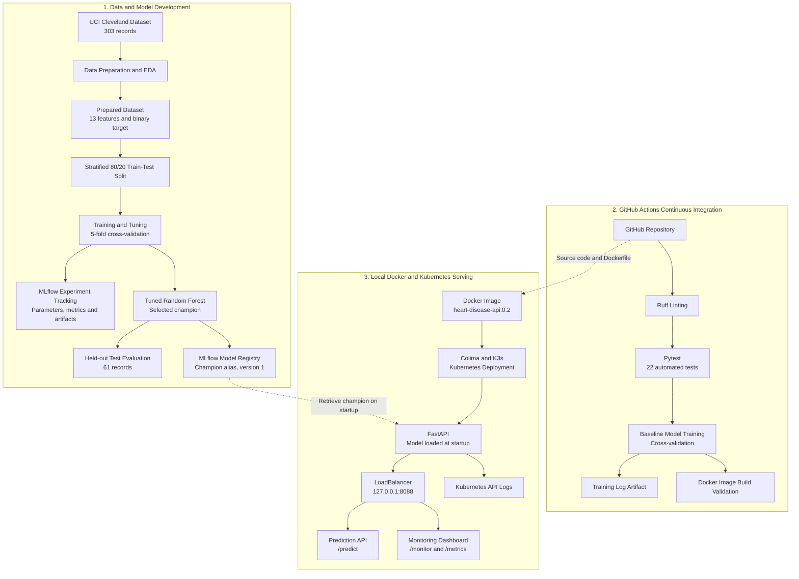

# Heart Disease MLOps Architecture

This diagram describes the implemented local MLOps system.
GitHub Actions performs CI validation; Kubernetes deployment
is performed locally and is not an automatic CI release.

## Architecture Notes

- The dataset is prepared from the UCI Cleveland source.
- Scikit-learn Pipelines include preprocessing and classifiers.
- Cross-validation and tuning use training data only.
- The selected tuned Random Forest is registered in MLflow.
- The FastAPI application loads the registered model at startup.
- The serving container runs in local Kubernetes using Colima and K3s.
- The Kubernetes LoadBalancer is reachable from the host on port 8088.
- API metrics are held in memory and reset when the process restarts.
- GitHub Actions runs linting, tests, baseline training and Docker build validation.
- CI does not automatically publish the image or deploy to Kubernetes.
- The application is an academic demonstration, not a clinical system.
